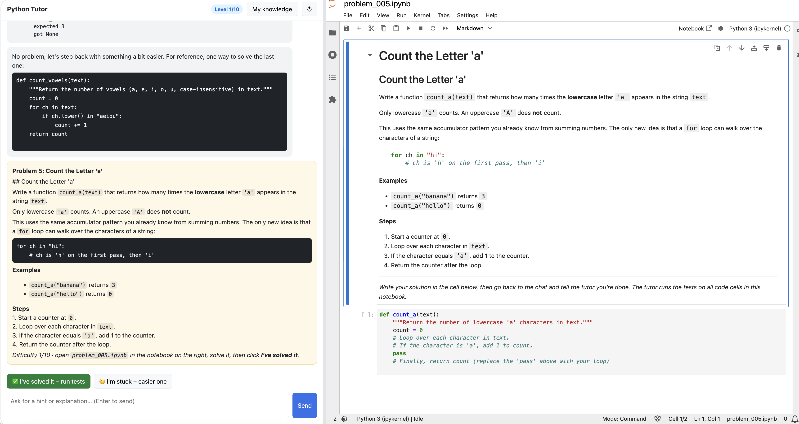

# Interactive Python Coding Tutor

Learn Python by solving coding problems, with an AI tutor beside you.



- **Left side:** a chat with your tutor. Ask for hints, explanations, or the next problem.
- **Right side:** a Jupyter notebook where you write and run your code.

How it works:

1. You tell the tutor what you already know about Python.
2. It gives you **one problem at a time**, with hidden test cases.
3. You solve it in the notebook, then click **"I've solved it – run tests"**.
4. Passed? You get a **harder** problem. Stuck? Click **"I'm stuck – easier one"**.
5. The tutor keeps notes on what you know. Click **"My knowledge"** to see where you started and where you are now.

> You don't need to know anything about programming tools to set this up. Just follow the steps for your computer.
> Setup takes about 10–15 minutes, mostly waiting for downloads.

---

## What you need

| Requirement | Why |
|---|---|
| A Mac or a Windows PC | |
| An internet connection | To download things and talk to the AI |
| **Python 3.10 or newer** | The programming language this app is built with (steps below) |
| **One AI option** (pick one, see [Step 3](#step-3--choose-your-ai)) | The "brain" of the tutor |

---

# Setup on a Mac

### Step 1 – Install Python

1. Open **Terminal**. Press `Cmd + Space`, type `Terminal`, press `Enter`. (A window with a text prompt opens. This is where you'll type commands.)
2. Check whether Python is already installed. Type this and press `Enter`:
   ```
   python3 --version
   ```
   - If it shows `Python 3.10` or higher (for example `Python 3.12.4`) → **skip to Step 2**.
   - If it shows a lower version, an error, or a pop-up asks to install "developer tools" → install Python as below.
3. Go to <https://www.python.org/downloads/>, click the big yellow **Download Python** button, open the downloaded `.pkg` file, and click **Continue / Agree / Install** until it finishes.
4. **Close Terminal and open it again**, then run `python3 --version` again to confirm.

### Step 2 – Download the tutor

1. Open <https://github.com/cloudxlab/interactive-coding-tutor> in your browser.
2. Click the green **Code** button → **Download ZIP**.
3. Open your **Downloads** folder and double-click the ZIP file to unzip it. You get a folder named `interactive-coding-tutor-main`.
4. Move that folder somewhere easy to find, like your **Documents** folder.

*(If you already use git, you can run `git clone https://github.com/cloudxlab/interactive-coding-tutor.git` instead.)*

### Step 3 – Choose your AI

The tutor needs an AI to create problems and answer your questions. Pick **one**. `setup` will ask you which one and guide you through it.

| Option | What you need | Cost |
|---|---|---|
| **Anthropic (Claude) API key** | An account at console.anthropic.com | Pay-as-you-go. Typically a few cents per hour of practice. |
| **OpenAI API key** | An account at platform.openai.com. (A ChatGPT subscription is *not* enough.) | Pay-as-you-go. Typically a few cents per hour of practice. |
| **OpenRouter** | An account at openrouter.ai. You can sign in through your browser during setup (no key to copy), or paste a key. One account gives access to many models (Claude, GPT, Gemini and more), and some are free. | Pay-as-you-go, depending on the model you pick. |
| **`claude` command line** | A paid Claude subscription (Pro or Max) and the Claude Code app installed and signed in | Covered by your subscription. No key to copy. |

An **API key** is a long password-like text that lets the app use the AI on your account. Keep it private. Never share it or post it online.
The setup script shows the exact steps to get a key when you choose that option.

### Step 4 – Run setup (once)

1. In Terminal, type `cd ` (the letters c, d, then a **space**), then **drag the `interactive-coding-tutor-main` folder from Finder into the Terminal window**. The folder's path appears. Press `Enter`.
2. Type this and press `Enter`:
   ```
   bash setup.sh
   ```
3. Wait while it installs things (a few minutes). Then answer the questions:
   - Choose `1`, `2`, `3` or `4` for your AI and follow the on-screen steps.
   - When it asks for your key, **paste it** (`Cmd + V`). You won't see anything appear. That's normal and it's for your safety. Press `Enter`.
   - Press `Enter` at "Model override" to use the default.

You'll see **"Setup complete."**

### Step 5 – Start the tutor

In the same Terminal window (inside the folder), run:
```
bash launch.sh
```
Your browser opens the tutor automatically. If it doesn't, open <http://localhost:8765> yourself.

**Next time:** open Terminal, type `cd ` + drag the folder in + `Enter`, then `bash launch.sh`. You don't need to run setup again.

**To stop the tutor:** go to the Terminal window and press `Ctrl + C`.

---

# Setup on Windows

### Step 1 – Install Python

1. Go to <https://www.python.org/downloads/> and click **Download Python**.
2. Open the downloaded installer.
3. ⚠️ **Very important:** on the first screen, tick the box **"Add python.exe to PATH"** (at the bottom), *then* click **Install Now**.
4. When it finishes, click **Close**.

### Step 2 – Download the tutor

1. Open <https://github.com/cloudxlab/interactive-coding-tutor> in your browser.
2. Click the green **Code** button → **Download ZIP**.
3. Open your **Downloads** folder, **right-click** the ZIP file → **Extract All…** → **Extract**.
   (Don't just double-click and run files from inside the ZIP. That won't work.)
4. Move the extracted folder `interactive-coding-tutor-main` somewhere easy to find, like **Documents**.

### Step 3 – Choose your AI

Same as for Mac. See the [table above](#step-3--choose-your-ai). `setup` will ask which one and guide you.

### Step 4 – Run setup (once)

1. Open the `interactive-coding-tutor-main` folder in File Explorer.
2. **Double-click `setup.bat`.**
   - If Windows shows a blue **"Windows protected your PC"** screen: click **More info** → **Run anyway**. (This appears for any downloaded script.)
3. A black window opens and installs things (a few minutes). Then answer the questions:
   - Type `1`, `2`, `3` or `4` for your AI and press `Enter`. Follow the on-screen steps.
   - When it asks for your key, **paste it** (right-click in the window, or `Ctrl + V`). You won't see anything appear. That's normal. Press `Enter`.
   - Press `Enter` at "Model override" to use the default.
4. When you see **"Setup complete"**, press any key to close the window.

### Step 5 – Start the tutor

**Double-click `launch.bat`.** A black window opens and, after a few seconds, your browser opens the tutor. If it doesn't, open <http://localhost:8765> yourself.

**Keep the black window open** while you use the tutor. **To stop**, click the black window and press `Ctrl + C`, or just close it.

**Next time:** just double-click `launch.bat`. No need to run setup again.

---

# Using the tutor

1. **Tell the tutor about yourself.** On the first screen, describe what you know in your own words, for example *"I can write simple expressions and basic functions, but I struggle with simple LeetCode problems. I'd like to start with loops."* Click **Start learning** and wait about 10–30 seconds for your first problem.
2. **Read the problem** in the chat on the left. A notebook for it opens on the right.
3. **Write your solution** in the empty code cell of the notebook, between the `def ...` line and the end. Run the cell with `Shift + Enter` to try it yourself. Use `print(...)` to experiment.
4. **Check your work.** Click **"✅ I've solved it – run tests"**. The tutor runs hidden tests on your code and shows each one with ✓ or ✗, what it expected, and what your code gave.
5. **Failed some tests?** Fix your code and click the button again. Ask the chat for a hint. The tutor will nudge you, not hand you the answer.
6. **Passed everything?** Click **"➡ Next problem"** for a harder one.
7. **Really stuck?** Click **"😕 I'm stuck – easier one"**. The tutor shows one way to solve the one you were on and gives you an easier problem.

**Tips**
- The notebook **saves automatically every 5 seconds**. If tests don't see your latest change, wait a moment or save (`Cmd + S` on Mac, `Ctrl + S` on Windows) and try again.
- The tutor tests **all code cells** in the notebook, so keep your final solution defined in a cell (and leave the function name as given).
- You can drag the thin bar between the chat and the notebook to resize them.
- **↺** (top left) erases your progress and starts over.
- Your progress is saved on your computer, so you can close everything and continue later.

---

# Troubleshooting

| Problem | What to do |
|---|---|
| **Mac:** `python3: command not found`, or a pop-up about "developer tools" | Install Python from <https://www.python.org/downloads/> (Step 1), then reopen Terminal. |
| **Mac:** `No such file or directory` when running `bash setup.sh` | You're not in the right folder. Redo "Step 4.1" and drag the folder into Terminal after `cd `. |
| **Windows:** setup says *"Python 3.9 or newer was not found"* | Re-run the Python installer, choose **Modify/Repair**, and make sure **"Add python.exe to PATH"** is ticked. Then run `setup.bat` again. |
| **Windows:** the window flashes and closes | Open the folder, click the address bar, type `cmd`, press `Enter`, then type `setup.bat` (or `launch.bat`) so you can read the message. |
| *"Port 8765 / 8766 is already in use"* | The tutor is already running in another window. Close it (or restart your computer) and try again. |
| *"API key"* errors in the chat, or the key looks rejected | Run setup again (`bash setup.sh` / `setup.bat`) and paste a fresh key. Make sure your account has credits. |
| Chat says the **`claude` command failed** | Open a terminal, run `claude` and sign in, then try again. |
| A **blank/loading** notebook on the right | Wait ~10 seconds and refresh the browser page. If it persists, stop and re-launch. |
| *"Permission denied"* running `./setup.sh` on Mac | Use `bash setup.sh` instead (with the word `bash` in front). |
| Tests fail but you're sure your code is right | Check that your function name and the number/order of arguments match the problem exactly, and that you removed the `pass` line. |
| First problem takes long | Normal. The AI is writing it *and* checking its own tests. Using the `claude` option is a bit slower than API keys. |

Something else? The setup and launch windows print the error. Copy it and ask for help, **but never paste your API key**.

---

# Running it for many people (multi-user)

Want a shared version where people **sign in with Google, GitHub or Microsoft**, each with their own progress and
their own isolated notebook environment? That is a separate, more advanced setup for whoever runs a server. Beginners
using the tutor on their own computer don't need it. See **[docs/MULTIUSER.md](docs/MULTIUSER.md)** and run
`python3 setup_multiuser.py`.

---

# For developers

Everything above uses the helper scripts. If you prefer to do it by hand:

```
python3 -m venv .venv
.venv/bin/pip install -r requirements.txt          # Windows: .venv\Scripts\pip
.venv/bin/python app.py                             # Windows: .venv\Scripts\python app.py
```

**LLM backend** (auto-detected in this order, or force with `TUTOR_LLM=anthropic|openai|openrouter|claude-cli`):
`ANTHROPIC_API_KEY` → `OPENAI_API_KEY` (needs `pip install openai`) → `OPENROUTER_API_KEY` → the `claude` command (uses your Claude Code login).

### OpenRouter

OpenRouter's OpenAI-compatible API is called directly over HTTPS (no extra package). Settings, in `.env` or your environment:

| Variable | Meaning |
|---|---|
| `OPENROUTER_API_KEY` | your key (`sk-or-...`) |
| `TUTOR_MODEL` | model id as `provider/model`, e.g. `anthropic/claude-sonnet-4.5` (default), `openai/gpt-4.1`. Browse <https://openrouter.ai/models> |
| `OPENROUTER_BASE_URL` | optional, default `https://openrouter.ai/api/v1` |

Easiest path: run `./setup.sh` (or `setup.bat`) and choose **3) OpenRouter**.

### OpenRouter OAuth helper (`openrouter_oauth.py`)

Gets an API key by signing in with OpenRouter (OAuth **PKCE**). No copy/paste and no client secret. Standard library only.

```
python openrouter_oauth.py                # sign in, save OPENROUTER_API_KEY and TUTOR_LLM=openrouter to .env
python openrouter_oauth.py --print-key    # sign in, print only the key (for scripts; setup.sh uses this)
python openrouter_oauth.py --manual       # no local server: paste the code from the redirect URL
python openrouter_oauth.py --no-browser   # print the sign-in URL instead of opening a browser
python openrouter_oauth.py --env-file X   # save somewhere other than .env
```

How the flow works:
1. The script creates a random `code_verifier` and sends its SHA-256 hash (`code_challenge`, method `S256`) to `https://openrouter.ai/auth?callback_url=...`.
2. Your browser opens; you sign in and click **Authorize**.
3. OpenRouter redirects to `http://localhost:3000/?code=...`, where the script is listening. (OpenRouter allows `http://localhost:3000` for development and requires https for everything else. If port 3000 is busy, free it or use `--manual`.)
4. The script POSTs `{code, code_verifier, code_challenge_method}` to `https://openrouter.ai/api/v1/auth/keys` and receives `{"key": "sk-or-..."}`.
5. The key is written to `.env` (other lines preserved, file mode 600).

To build a *hosted* app that signs users in with OpenRouter, reuse `make_pkce()`, `build_auth_url()` and `exchange_code()` from that file, and register an https `callback_url` on your own domain.

**Environment variables:** `TUTOR_PORT` (8765), `TUTOR_JUPYTER_PORT` (8766), `TUTOR_MODEL` (optional model override).

**Files:** `app.py` (backend + AI + JupyterLab launcher), `runner.py` (runs your code and the tests in a separate process), `static/index.html` (the web UI), `openrouter_oauth.py` (OpenRouter sign-in helper), `setup.sh`/`launch.sh` (Mac/Linux), `store.py` `auth.py` `proxy.py` `sandbox.py` (multi-user mode), `setup.ps1`/`launch.ps1` + `.bat` wrappers (Windows). Progress is saved in `state.json`, notebooks in `workspace/`, your settings and key in `.env` (not committed to git).

**Notes:** your code runs locally in a plain subprocess with no sandbox, which is fine for a single-user local tool. Tests run on the *saved* notebook file. The Windows scripts are newer than the Mac/Linux ones, so please report any problems.
